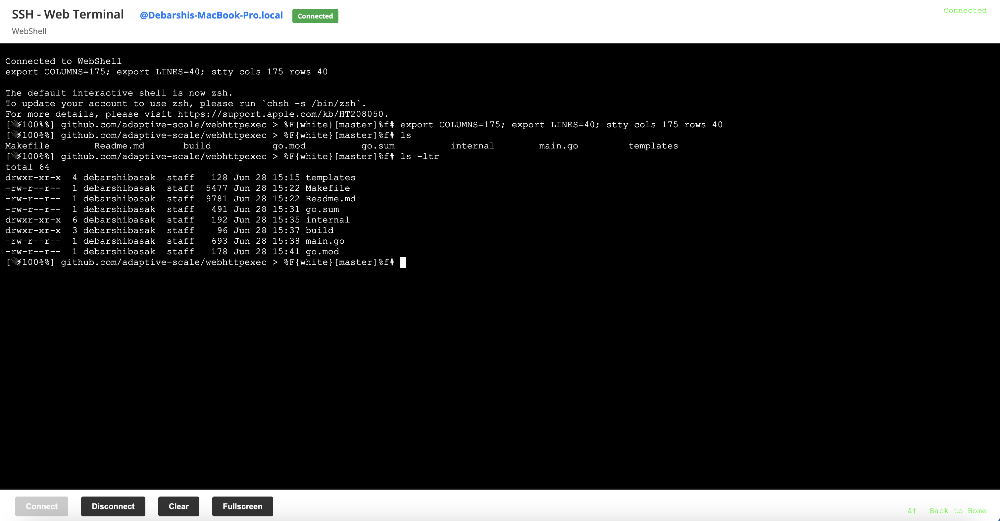

## WebShell

A secure HTTP server that can execute CLI commands via REST API endpoints using simple raw body requests. Returns command output as raw text by default, with JSON metadata available on request. Includes a full-featured web SSH terminal for interactive shell access.



## Quick Install

### 安装

从可信源码取得本仓库的 `install.sh`，或从已启用不可变制品的 [WebShell Release](https://github.com/buildHelpers/webshell/releases) 获取并核对脚本摘要。运行 `bash install.sh v1.2.5` 会核对所选平台的制品摘要后安装，需要 `curl`、`python3` 和 `openssl`。

Linux 上可使用 `bash install.sh v1.2.5 --service` 安装 systemd 服务。执行前设置 `AUTH_TOKEN`，安装器会报告证书的 SHA-256 指纹。

### Supported Platforms

- **Linux AMD64**: `webshell_linux_amd64`
- **Linux ARM64**: `webshell_linux_arm64` (Raspberry Pi, etc.)
- **macOS AMD64**: `webshell_darwin_amd64` (Intel Macs)
- **macOS ARM64**: `webshell_darwin_arm64` (Apple Silicon M1/M2)
- **Windows AMD64**: `webshell.exe`

## Features

- 🚀 **RESTful API** - Execute commands via HTTP POST requests with raw body
- 📝 **Raw Text Output** - Get clean command output without JSON wrapper
- 🖥️ **Web SSH Terminal** - Full interactive terminal in your browser
- 🔒 **Security First** - Whitelist of allowed commands only
- ⏱️ **Timeout Protection** - 30-second command execution timeout
- 📊 **Detailed Responses** - JSON metadata available with Accept header
- 🏥 **Health Check** - Built-in health monitoring endpoint
- 🎨 **Beautiful UI** - Interactive web interface for testing
- 🛠️ **Makefile Support** - Comprehensive build and development tools
- 📤 **File Upload** - Upload files to server with overwrite/skip options
- 📥 **File Download** - Download files from server by path
- 🔐 **Secure Path Prefix** - Customize all endpoint paths for enhanced security
- 🔒 **HTTPS Support** - TLS/SSL certificate support for secure connections

## 固定访问入口

启动本地二进制前，请通过环境变量 `AUTH_TOKEN`、`CERT_FILE` 和 `KEY_FILE` 配置长期 Token、可信证书和私钥。可用 `PORT`、`SECURE_PATH` 指定端口与路径前缀。

收藏 `https://服务器:端口/路径前缀/terminal`。路径前缀为 `/` 时，入口是 `https://服务器:端口/terminal`。在页面输入长期 Token 后，浏览器会获取一张 30 秒内可用一次的终端票据。浏览器需要信任该服务器的证书。

API 调用在 HTTPS 请求头中传入 `X-Auth-Token` 或 `Authorization: Bearer …`。以下示例使用可信渠道取得的服务器证书。

```bash
curl --cacert "$CERT_FILE" -H "X-Auth-Token: $AUTH_TOKEN" \
  https://localhost:8080/api/v1/status
```

## Using Makefile

The project includes a comprehensive Makefile for easy development and deployment. Run `make help` to see all available commands.

### Quick Makefile Commands

```bash
# Show all available commands
make help

# Run the application
make run

# Build the application
make build

# Run with hot reload (development)
make dev

# Run tests
make test

# Format and vet code
make check
```

### Build Commands

```bash
# Build for current platform
make build

# Build for specific platforms
make build-linux    # Linux binary
make build-darwin   # macOS binary
make build-windows  # Windows binary

# Build for all platforms
make build-all

# Build and run
make run-build
```

### Development Commands

```bash
# Run with hot reload (requires air)
make dev

# Install development tools
make setup

# Run code quality checks
make fmt           # Format code
make vet           # Vet code
make lint          # Run linter
make check         # Format, vet, and test
make pre-commit    # All pre-commit checks

# Run tests
make test              # Run tests
make test-coverage     # Run tests with coverage
make test-bench        # Run benchmark tests
```

### Dependency Management

```bash
# Download dependencies
make deps

# Update dependencies
make deps-update

# Clean module cache
make deps-clean
```

### Docker Commands

```bash
# Build Docker image
make docker-build

# Run Docker container
make docker-run

# Clean Docker images
make docker-clean
```

### Release Commands

```bash
# Build release binaries for all platforms
make release

# Build release binary for Linux only
make release-linux

# Install to GOPATH/bin
make install
```

### Clean Commands

```bash
# Clean build artifacts
make clean

# Clean everything including dependencies
make clean-all
```

### Custom Port Usage

```bash
# Run on custom port
PORT=3000 make run

# Build and run on custom port
PORT=3000 make run-build

# Docker run on custom port
PORT=3000 make docker-run
```

### 认证

启动必须配置长期 Token。命令执行、文件传输和应用集成 API 使用请求头认证。服务首页、健康检查与终端登录页可直接访问。浏览器仅将长期 Token 提交给同源 HTTPS 的票据签发端点。

### Secure Path Prefix

WebShell supports custom path prefixes for all endpoints to enhance security. This allows you to hide the actual endpoint paths behind a random or custom prefix.

**Using Command Line:**
```bash
# Use custom path prefix (e.g., 16 random characters)
./webshell -path /a1b2c3d4e5f6g7h8/

# All endpoints will be available under this prefix:
# - /a1b2c3d4e5f6g7h8/execute
# - /a1b2c3d4e5f6g7h8/upload
# - /a1b2c3d4e5f6g7h8/download
# - /a1b2c3d4e5f6g7h8/terminal
# - /a1b2c3d4e5f6g7h8/ws
```

**Using Environment Variable:**
```bash
# Set path prefix via environment variable
export SECURE_PATH="/abc123/"
./webshell

# Path will be automatically normalized (adds leading/trailing slashes if missing)
```

**Path Normalization:**
- Paths are automatically normalized to start with `/` and end with `/`
- Examples: `abc123` → `/abc123/`, `/abc123` → `/abc123/`
- If not specified, defaults to `/` (standard paths)

**Example with Path Prefix:**
```bash
# Start server with path prefix
./webshell -token mytoken -path /xyz789/

# Access endpoints
curl -X POST https://localhost:8080/xyz789/execute \
  -H "Authorization: Bearer mytoken" \
  -d "ls -la"
```

### HTTPS/TLS Support

WebShell supports HTTPS with TLS certificates for secure connections.

**Using Command Line:**
```bash
# Start with HTTPS
./webshell -cert /path/to/cert.pem -key /path/to/key.pem

# Combine with other options
./webshell \
  -token mytoken \
  -path /abc123/ \
  -cert /path/to/cert.pem \
  -key /path/to/key.pem \
  -port 8443
```

**Using Environment Variables:**
```bash
# Set certificate paths via environment variables
export CERT_FILE=/path/to/cert.pem
export KEY_FILE=/path/to/key.pem
./webshell

# Or combine with other settings
export PORT=8443
export AUTH_TOKEN=mytoken
export SECURE_PATH=/abc123/
export CERT_FILE=/path/to/cert.pem
export KEY_FILE=/path/to/key.pem
./webshell
```

**HTTPS Behavior:**
- If both certificate and key are provided, server runs in HTTPS mode
- If certificate or key is missing, server runs in HTTP mode
- TLS minimum version: TLS 1.2
- Server automatically detects mode and logs it on startup

**Example HTTPS Request:**
```bash
# Access via HTTPS
curl -X POST https://localhost:8443/execute \
  -H "Authorization: Bearer mytoken" \
  -d "ls -la" \
  -k  # Skip certificate verification for self-signed certs
```

## API Endpoints

### POST /execute

Execute a command using raw body text. Returns raw output by default, or JSON with Accept header.

**Request Body (raw text):**
```
ls -la
```

**Response (raw text by default):**
```
total 8
drwxr-xr-x  2 user  staff  68 Dec 20 10:30 .
drwxr-xr-x  3 user  staff  102 Dec 20 10:30 ..
-rw-r--r--  1 user  staff  1234 Dec 20 10:30 main.go
```

**Response (JSON with Accept: application/json):**
```json
{
  "success": true,
  "output": "total 8\ndrwxr-xr-x  2 user  staff  68 Dec 20 10:30 .\n...",
  "exit_code": 0,
  "duration": "15.2ms",
  "timestamp": "2023-12-20T10:30:00Z",
  "command": "ls -la"
}
```

### GET /terminal

Interactive web SSH terminal with full shell access. Features:
- Real-time terminal emulation using xterm.js
- Full bash shell access
- WebSocket-based communication
- Connect/disconnect controls
- Terminal clearing functionality

### GET /health

Health check endpoint.

**Response:**
```json
{
  "status": "healthy",
  "timestamp": "2023-12-20T10:30:00Z",
  "uptime": "running"
}
```

### GET /

Interactive web interface with usage examples, documentation, and a test form.

### POST /upload

Upload files to the server. Supports overwrite and skip options.

**Request (multipart/form-data):**
```bash
curl -X POST https://localhost:8080/upload \
  -H "Authorization: Bearer your-token" \
  -F "file=@/path/to/local/file.txt" \
  -F "path=/server/path/file.txt" \
  -F "overwrite=true"
```

**Parameters:**
- `file` (required): The file to upload
- `path` (required): Target path on the server
- `overwrite` (optional): Set to `true` to overwrite existing files, defaults to `false` (skip)

**Response (success):**
```json
{
  "status": "success",
  "message": "File uploaded successfully",
  "path": "/server/path/file.txt",
  "filename": "file.txt",
  "size": 1234,
  "overwritten": false
}
```

**Response (skipped):**
```json
{
  "status": "skipped",
  "message": "File already exists, skipped",
  "path": "/server/path/file.txt"
}
```

**Features:**
- Automatically creates parent directories if they don't exist
- Supports overwrite mode (replace existing files) or skip mode (preserve existing files)
- Returns file metadata including size and upload status

**Example with path prefix:**
```bash
# Upload with custom path prefix
curl -X POST https://localhost:8080/abc123/upload \
  -H "Authorization: Bearer your-token" \
  -F "file=@/path/to/local/file.txt" \
  -F "path=/server/path/file.txt" \
  -F "overwrite=true"
```

### GET /download

Download files from the server by path.

**Request:**
```bash
curl -X GET "https://localhost:8080/download?path=/server/path/file.txt" \
  -H "Authorization: Bearer your-token" \
  -o downloaded_file.txt
```

**Query Parameters:**
- `path` (required): Path to the file on the server

**Response:**
- Returns the file content with appropriate headers for download
- Sets `Content-Disposition` header for proper filename handling
- Returns 404 if file doesn't exist
- Returns 400 if path is a directory

**Example:**
```bash
# Download a file
curl -X GET "https://localhost:8080/download?path=/var/log/app.log" \
  -H "Authorization: Bearer your-token" \
  -o app.log

# Download with path prefix
curl -X GET "https://localhost:8080/abc123/download?path=/var/log/app.log" \
  -H "Authorization: Bearer your-token" \
  -o app.log
```

## Web Terminal Features

The web terminal provides a full interactive shell experience:

- **Real-time Interaction**: Type commands and see output immediately
- **Full Shell Access**: Access to all bash features and commands
- **Responsive Design**: Works on desktop and mobile devices
- **Connection Management**: Connect/disconnect as needed
- **Terminal Controls**: Clear terminal, manage connections
- **Secure**: Each session is isolated and cleaned up properly

### Using the Web Terminal

1. Navigate to `https://localhost:8080/terminal`
2. Click "Connect" to start a shell session
3. Type commands as you would in a regular terminal
4. Use "Disconnect" to end the session
5. Use "Clear" to clear the terminal output

## Allowed Commands

For security reasons, only the following commands are allowed in the REST API:

- `ls` - List directory contents
- `pwd` - Print working directory
- `whoami` - Print effective user ID
- `date` - Print or set system date and time
- `uptime` - Show system uptime
- `ps` - Report process status
- `df` - Report file system disk space usage
- `free` - Display amount of free and used memory
- `top` - Display system processes
- `cat` - Concatenate and print files
- `head` - Output the first part of files
- `tail` - Output the last part of files
- `grep` - Print lines matching a pattern
- `find` - Search for files in a directory hierarchy
- `echo` - Display a line of text
- `uname` - Print system information
- `hostname` - Print or set system hostname

**Note**: The web terminal provides full shell access and is not restricted to the above commands.

## Complete Configuration Example

Here's a complete example with all features enabled:

```bash
# Start WebShell with all security features
./webshell \
  -port 8443 \
  -token "your-strong-random-token" \
  -path "/a1b2c3d4e5f6g7h8/" \
  -cert "/path/to/certificate.pem" \
  -key "/path/to/private-key.pem"
```

Or using environment variables:

```bash
export PORT=8443
export AUTH_TOKEN="your-strong-random-token"
export SECURE_PATH="/a1b2c3d4e5f6g7h8/"
export CERT_FILE="/path/to/certificate.pem"
export KEY_FILE="/path/to/private-key.pem"
./webshell
```

**Access endpoints:**
- Home: `https://localhost:8443/a1b2c3d4e5f6g7h8/`
- Execute: `https://localhost:8443/a1b2c3d4e5f6g7h8/execute`
- Upload: `https://localhost:8443/a1b2c3d4e5f6g7h8/upload`
- Download: `https://localhost:8443/a1b2c3d4e5f6g7h8/download`
- Terminal: `https://localhost:8443/a1b2c3d4e5f6g7h8/terminal`
- WebSocket: `wss://localhost:8443/a1b2c3d4e5f6g7h8/ws`

## Security Considerations

⚠️ **Important Security Notes:**

1. **Command Whitelist**: Only predefined commands are allowed in the REST API to prevent arbitrary code execution
2. **Web Terminal**: Provides full shell access - use with extreme caution in production
3. **Timeout Protection**: Commands have a 30-second timeout to prevent hanging processes
4. **Input Validation**: All inputs are validated before execution
5. **Production Use**: This server is designed for development/testing. Use with caution in production environments
6. **Network Access**: Always use authentication and HTTPS for production use
7. **Session Isolation**: Each web terminal session is isolated and cleaned up properly
8. **Secure Path Prefix**: Use random path prefixes to hide endpoint locations
9. **File Upload Security**: Be cautious with file uploads - validate file types and sizes in production
10. **HTTPS**: Always use HTTPS with valid certificates in production environments
